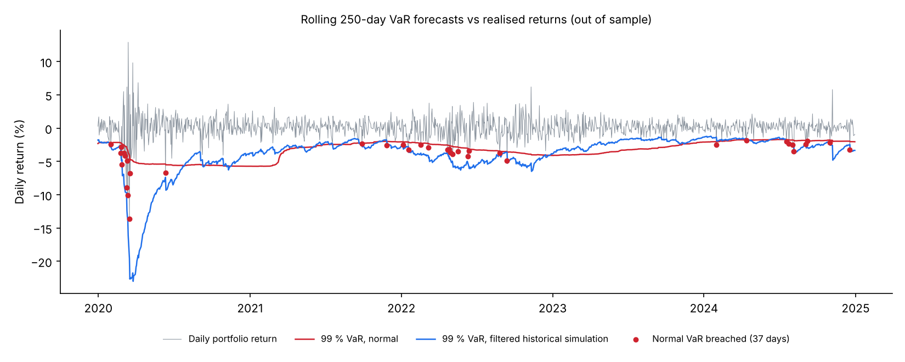

# Quant Risk Engine: VaR, Backtesting and Portfolio Risk

Market-risk toolkit for an equity portfolio: four ways to compute Value at Risk and Expected Shortfall, a regulatory-style **VaR backtest** (Kupiec test, Basel traffic light), Monte Carlo simulation, historical stress scenarios and Markowitz optimisation, on real market data.

[](https://github.com/alaaeddinethr/quant-risk-engine/actions/workflows/ci.yml)


Built alongside my MSc in Financial Engineering (WorldQuant University).

## The question

A 99 % one-day VaR claims: "on 99 days out of 100, we will not lose more than this". A risk model is only worth something if that claim holds on days it has not seen. So the core of this project is not computing VaR, it is **testing it out of sample**.

## Results

Equal-weight portfolio of AAPL, MSFT, GOOGL, JPM, GS and BRK-B, daily rebalanced, 2 Jan 2019 to 30 Dec 2024 (1,508 trading days, Yahoo Finance). Reproduce with `python scripts/make_readme_figures.py`.

| Portfolio | Value |
|---|---|
| Annual growth (CAGR) | 26.5 % |
| Annual volatility | 23.3 % |
| Sharpe ratio (rf = 0) | 1.01 |
| Maximum drawdown | −34.0 % |
| Excess kurtosis of daily returns | 13.8 (normal = 0) |

**Backtest of the 99 % one-day VaR.** Each day the model is re-estimated on the previous 250 days only, then compared with the next day's return. 1,258 days tested, 12.6 exceptions expected.

| VaR model | Exceptions | Per 250 days | Kupiec p-value | Basel zone |
|---|---|---|---|---|
| Historical simulation | 30 | 6.0 | < 0.001 | yellow |
| Normal (variance-covariance) | 37 | 7.4 | < 0.001 | yellow |
| Student-t | 34 | 6.8 | < 0.001 | yellow |
| EWMA volatility (RiskMetrics) | 33 | 6.6 | < 0.001 | yellow |
| **Filtered historical simulation** | **20** | **4.0** | **0.053** | **green** |



**What it shows.** Daily returns are far from normal (kurtosis 13.8), and volatility comes in clusters: calm in 2019, extreme in March 2020. Models fitted on a calm year with equal weights were caught out by COVID. Fatter tails alone (Student-t) or faster volatility alone (EWMA) are not enough. Combining both, by scaling empirical shocks with the current volatility (filtered historical simulation, Barone-Adesi et al., 1999), is the only model whose exception count is statistically consistent with 1 % and in the Basel green zone.

## What the engine does

| Module | Content |
|---|---|
| `risk/var.py` | VaR and Expected Shortfall: historical, parametric normal, Student-t, Monte Carlo; portfolio VaR with correlated simulation |
| `risk/backtest.py` | Rolling out-of-sample VaR backtest, Kupiec POF test, Basel traffic light, EWMA and filtered historical simulation |
| `risk/monte_carlo.py` | Multi-asset Monte Carlo of portfolio value, loss probabilities, percentile bands |
| `risk/stress_test.py` | Historical scenarios replayed on the current portfolio: 2000 dot-com, 2008 crisis, 2020 COVID, 2022 rate shock |
| `portfolio/metrics.py` | CAGR, volatility, Sharpe, Sortino, Calmar, drawdowns, skewness, kurtosis |
| `portfolio/optimizer.py` | Minimum variance, maximum Sharpe, risk parity, efficient frontier |
| `dashboard/app.py` | Streamlit dashboard |

## Run it

```bash
pip install -r requirements.txt
python scripts/make_readme_figures.py                      # results and figure above
python src/data/market_data.py --tickers AAPL MSFT GOOGL JPM GS --years 5
streamlit run src/dashboard/app.py
pytest tests                                               # 72 tests, no network needed
```

## Limitations

- Exceptions cluster around March 2020 even for the best model; an independence test (Christoffersen) would quantify it.
- Equal weights are a reference portfolio, not a recommendation; transaction costs are ignored.

## References

- Kupiec, P. (1995). Techniques for verifying the accuracy of risk measurement models. *Journal of Derivatives*, 3(2).
- Barone-Adesi, G., Giannopoulos, K., Vosper, L. (1999). VaR without correlations for portfolios of derivative securities. *Journal of Futures Markets*, 19(5).
- Basel Committee on Banking Supervision (1996). Supervisory framework for the use of backtesting in conjunction with the internal models approach to market risk capital requirements.
- J.P. Morgan / Reuters (1996). *RiskMetrics Technical Document*.
- Jorion, P. (2006). *Value at Risk*. McGraw-Hill.

---

Alaa Eddine Tahir, engineering student at Arts et Métiers and MSc Financial Engineering student at WorldQuant University. [LinkedIn](https://linkedin.com/in/alaaeddine-tahir)
